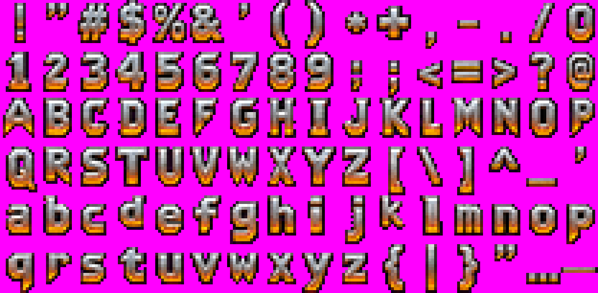

# Polices Doom alternatives — CYD

Variantes de planches BMP destinées aux essais de thème, **sans remplacer** les ressources existantes ni modifier le moteur. La PR #407 ajoute aussi `sdroot/doomrpg/img/a_doom.bmp` (144 × 72), distinct de cette famille `larger_font`.

## Fichiers à copier sur SD

| Fichier | Dimensions | Encodage | Taille | Usage |
| --- | --- | --- | ---: | --- |
| `larger_font_doom.bmp` | 208 × 102 | BMP indexé 4 bpp, palette de 16 couleurs | 10 726 o | **Essai prioritaire**, chrome et orange |
| `larger_font_doom_compat3.bmp` | 208 × 102 | BMP indexé 4 bpp, palette de 3 couleurs | 10 676 o | Variante conservatrice, palette/poids alignés sur `larger_font.bmp` |
| `larger_font_doom_24bit.bmp` | 208 × 102 | BMP RGB 24 bpp | 63 702 o | Fidélité visuelle, compatibilité du décodeur à vérifier |

Les 96 glyphes ont été repositionnés par rapport à `larger_font.bmp` (208 × 102) ; fond rose magenta. Les dimensions identiques **ne garantissent pas** à elles seules la prise en charge runtime : palette, couleur transparente, chargement et ordre des glyphes doivent être confirmés sur le vrai CYD.



## Surcharge native sur SD (branche `agent/font-sd-overrides-pak-fallback`)

Le firmware recherche uniquement les noms **exacts** ci-dessous, sur la carte SD montée :

| Planche du moteur | Fichier SD optionnel |
| --- | --- |
| `a.bmp` (144 × 72) | `/doomrpg/img/a.bmp` |
| `larger_font.bmp` (208 × 102) | `/doomrpg/img/larger_font.bmp` |

Pour essayer **les graphismes Doom présents dans ce dépôt**, copier et **renommer** :

```text
sdroot/doomrpg/img/a_doom.bmp              -> <carte SD>/doomrpg/img/a.bmp
sdroot/doomrpg/img/larger_font_doom.bmp    -> <carte SD>/doomrpg/img/larger_font.bmp
```

Les variantes sources ne sont pas renommées dans Git : seules les **copies SD** utilisent les noms attendus. Les assets existants du PAK sont inchangés.

Le lecteur natif accepte seulement les BMP indexés non compressés **1, 4 ou 8 bits**. `larger_font_doom_24bit.bmp` (24 bits) est une référence visuelle : **ne pas le renommer pour le runtime**, il entraînerait un repli sur le PAK. Les dimensions incorrectes, les fichiers absents/incompatibles et les erreurs de décodage initial entraînent aussi le fallback. Une panne SD pendant un blit échoue de manière bornée et l'ouverture suivante utilise le PAK ; pas de buffer de pixels map-wide.

Le Canvas charge la texture indexée compacte une seule fois ; les HUD/dialogues/HUB lisent les plages glyphes à la demande sans image complète. Les fichiers SD sont des **surcharges optionnelles**, le PAK natif `/DoomRPG-ESP32.pak` demeure la référence, **aucun ZIP runtime**. Les handles de polices sont suspendus avant les accès PAK physiques ; si un PAK est déjà physiquement ouvert sur SD, le rendu courant se replie sur le PAK pour éviter un conflit de lecteur. En mode PAK flash-backed, la surcharge SD est autorisée. Les décisions sont conservées pendant la session (redémarrer pour changer de fichiers).

Logs attendus (validation uniquement par le vrai classic CYD) :

```text
[FONTSD] ACTIVE name=a.bmp source=SD ...
[FONTSD] ACTIVE name=larger_font.bmp source=SD ...
[FONTSD] FALLBACK name=... reason=missing-or-size backing=PAK
[FONTSD] FALLBACK name=... reason=invalid-or-io backing=PAK
```

**PENDING CYD** : confirmer au moins un redémarrage sans surcharges, un avec les deux polices, un avec une police manquante, la RAM libre, la stabilité sonore, le rendu des dialogues/du HUD/du HUB et le retour menu.

## Essai matériel

Conserver une copie de `larger_font.bmp` et ne substituer que le fichier de la variante choisie sous ce nom **là où le moteur lit réellement cet asset**. Les fichiers de variantes sont intentionnellement ajoutés à `sdroot/doomrpg/img/` sous des noms séparés ; aucun mécanisme de sélection automatique n'est ajouté ici. Contrôler sur l'écran réel : caractères (majuscules/minuscules, ponctuation), alignement, transparence magenta et lecture du BMP par le décodeur.

**État : PENDING CYD**. Aucun PASS matériel ni changement firmware revendiqué. Éviter de merger pour une validation visuelle non observée si un gate matériel est exigé.

## SHA-256

```text
82cfce34ba230b56d4a152310f9df0b104782e308fde3c1c88c19fdd9334d2a9  larger_font_doom.bmp
283df2f765238a46694384972ce76b0c34ff6f17a4ad0a183b4a572f3ee6f669  larger_font_doom_compat3.bmp
cfbf9773633908368a47ce3cabd2a84f6a503b251c21db4adf53b1ca2c902721  larger_font_doom_24bit.bmp
f0c91cbbd830145d8e62a1aaa8f21fe6b9dad16d75c61c9cf1ea4d5e300e5c14  previews/larger_font_doom_zoom.png
```
