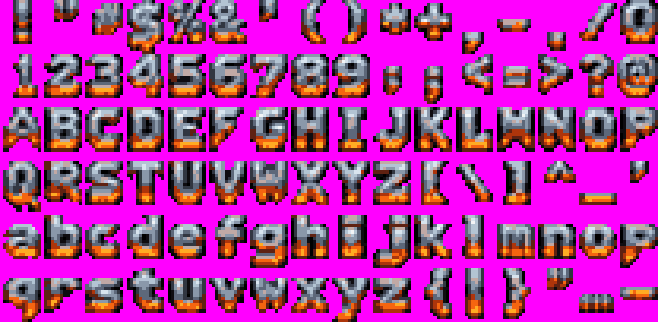

# Polices Doom alternatives — ESP32 classic CYD

Deux planches **4 bits, indexées, prêtes à copier sans renommage** dans
`/doomrpg/img/` sur la carte SD. Le jeu garde ses polices PAK d'origine
en fallback si le BMP SD est absent ou incompatible.

| Fichier runtime (dans `sdroot/doomrpg/img/`) | Taille | Cellule | Stockage |
| --- | --- | --- | --- |
| `a.bmp` | 144 × 72 | 9 × 12, 16 × 6 glyphes | **5 302 o**, BMP 4 bits, palette 16 couleurs |
| `larger_font.bmp` | 208 × 102 | 13 × 17, 16 × 6 glyphes | **10 726 o**, BMP 4 bits, palette 16 couleurs |

### Livraison SD dédupliquée et palette harmonisée (PR #413)
`a.bmp` est **le seul fichier petite police** : `a_doom.bmp` était son
**doublon binaire exact** et a été retiré du dossier de déploiement.
`larger_font.bmp` est désormais le seul grand atlas runtime ; sa palette
16 couleurs reprend **exactement les 16 entrées de `a.bmp`**. Depuis
le correctif intégral, **les 96 glyphes sont reconstruits depuis les formes ET les couleurs
de `a.bmp` avec exactement le même traitement**, y compris les deux
minuscules `a` et `o`. Plus d'exception stylistique ni de palette différente.
Le magenta transparent, les 96 cellules, l'en-tête, la palette et le BMP
4-bpp 208×102 restent strictement identiques au format antérieur.

La grande police historique non recolorée et la variante distincte
`larger_font_doom_compat3.bmp` (3 couleurs) sont conservées uniquement dans
`artwork/fonts/sources/` pour référence et comparaison, **pas** dans
`sdroot/`. L'ancienne variante BMP RGB24 non prise en charge reste accessible
dans l'historique Git de la PR #407. Aucun alias `_doom` n'est consommé
par le runtime ni requis sur la carte SD.

## Glyphes `a` et `o` puis reprise de toute la grande police

Le placement original avait produit un `o` minuscule coupé sur la petite
planche et des `a`/`o` déformés à différentes tailles. Les quatre glyphes
ont été reconstruits depuis les originaux métalliques, projetés sur les
**silhouettes des polices Doom RPG de référence**, puis quantifiés avec les
**palettes 16 couleurs existantes**. La silhouette évite toute modification
de l'avancement et de la découpe des cellules ; le dégradé argent/cuivre
reste conservé.

**PR #413 — correction complète après deux retours visuels :** les glyphes
du petit **`a.bmp` demeurent inchangés**. Les 96 glyphes de
`larger_font.bmp` utilisent désormais **tous la même transformation** :
silhouette 9×12 issue de `a.bmp`, reprojetée dans une cellule 13×17 avec
interpolation bicubique, quantifiée dans **sa palette Doom 16 couleurs**,
et magenta transparent. Le premier lot de 94 caractères était jugé bon
sur le CYD, mais les anciens `a`/`o` conservés faisaient tache.
Le dernier correctif ne modifie donc **que ces deux caractères**
(90 pixels pour `a`, 71 pour `o`) et préserve, pixel pour pixel,
les 94 caractères que tu as validés.

**Reconstruction reproductible :** source historique verrouillée
`artwork/fonts/sources/larger_font_pre_full_repair.bmp`,
`artwork/fonts/preview_full_repair.py --check`, et
`artwork/menu-uac/generic/tools/repair_assets.py --check`.
Le SHA256 du BMP SD final est
`9e16011cc6a6755bad5226143c342ec7339e47088f0c0dbdf3340518858f5350`,
l'oracle des 94 cellules `b4a46914a75ce8daee36f290c80f66fa5766e1a6887e87a47856d338b56b2bed`.
Le test `ESP32/test/font_sd_assets_host.py` vérifie la nouvelle forme
de `a` et `o`, la non-régression stricte des 94 autres caractères,
l'en-tête, le magenta, les 16 couleurs et la déduplication des noms SD.

## Couleurs à la volée

Le Canvas natif `EspNativeCanvas_drawText` appelle
`EspNativeTexture_setColorMod` avec `doomCanvas->fontColor`.
`EspNativeTexture_blit` multiplie ensuite chaque composante **RGB565**
de la palette BMP par la composante demandée (0–255 / 255) :
le résultat conserve les nuances locales argent/cuivre mais n'est **pas**
une simple couleur uniforme appliquée à une police blanche. Le BMP SD
reste source de couleur et n'est jamais réécrit par le rendu à la volée. Cette modulation est propre aux chemins de rendu qui
appliquent `setColorMod`, pas à tous les blits natifs indistinctement.

## Source des fichiers et preuve matérielle

Test réel antérieur au correctif des glyphes :
`platformio-device-monitor-261121-110206.log`, SHA-256
`950da58b2f5b04bbb7901e13375e8995a9be23858d9a3b56f5ebbf8625eb095d`.

- `[FONTSD] ACTIVE name=a.bmp source=SD indexed=4 palette=16 bytes=5302` ;
- Help/About atteint, texte de 112 lignes, pagination observée ;
- aucun panic/WDT dans les 328 lignes fournies ;
- `larger_font.bmp` **n'est pas observé comme chargé dans cet extrait**.

Ce log prouve le fonctionnement du **loader SD de la petite police avant
retouche**, pas la nouvelle forme des glyphes, ni le chargement de la grande,
ni les cas de fallback. Les fichiers corrigés exigent une nouvelle inspection
sur le vrai CYD pour déclarer l'aspect validé.

## Installation / fallback

Copier `sdroot/doomrpg/img/a.bmp` et
`sdroot/doomrpg/img/larger_font.bmp` vers les chemins SD de même nom ;
redémarrer le CYD après copie (pas de hot-reload).
Fichier absent/invalide : fallback sur `/DoomRPG-ESP32.pak` natif,
**jamais** sur le ZIP runtime. Le lecteur indexé accepte uniquement BMP
non compressés 1, 4 ou 8 bits ; la palette magenta est la clé transparente.

Le runtime garde un framebuffer logique 160 × 120 et des lecteurs bornés,
sans chargement d'un BMP24 de 63 Ko en RAM. Les thèmes, le code du moteur et le gameplay ne sont pas modifiés
par la reconstruction **des glyphes de grande police**.

## Gain de lisibilité de la teinte sur les glyphes SD (moteur)

Dans le chemin Canvas, `fontColor` module chaque composante de la palette
métallique. Pour éviter qu'une couleur de thème assombrisse trop le caractère,
la texture indique dorénavant explicitement si elle a été décodée **depuis
la SD**. Seulement lorsque cette texture est effectivement teintée,
`EspNativeFontTint_apply` relève les canaux RGB565 modulés d'environ 25 %,
avec saturation bornée. Noir, contours et canaux nuls demeurent noirs/nuls,
et la clé de transparence reste inchangée. Une police blanche/non teintée
et les textures PAK conservent exactement leur rendu historique.

La retouche ne modifie **aucun BMP** et ne s'applique **pas** aux autres
surfaces du thème, ni aux blits indexés directs du HUD/dialogue/HUB qui ne
passent pas par `EspNativeTexture_setColorMod`. Les chemins de recoloration
sont volontairement conservés distincts. Effet précis à vérifier sur CYD
avec les différentes couleurs de thème ; pas de validation matérielle
du gain de luminosité encore revendiquée.

### Vérification des nouveaux assets (PR #413)

`python artwork/menu-uac/generic/tools/repair_assets.py --check` refait
l'audit exact de la silhouette des deux boutons génériques et de la
palette de la grande police. La police PAK n'est pas modifiée ; le
rendu spécifique du mode UAC 120 applique la palette canonique même
lorsque le chargement se replie sur le PAK. La coloration générale du
Canvas reste dans son chemin de modulation existant.

## Aperçu des 96 cellules corrigées

Le zoom est nearest-neighbor ×4 depuis **le BMP SD final**, sans
filtre d'embellissement. Il permet de vérifier les 96 emplacements et
la transparence magenta indépendamment du firmware. Le test physique
de la lisibilité sur CYD reste **PENDING**.
