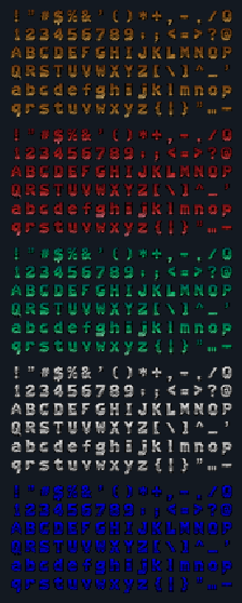

# FONT-NEUTRAL-P1 — Polices Doom recolorables, issue #423

**Assets seulement : aucun changement au firmware ou au moteur d'affichage.**

## Correction graphique : le grand atlas vient de `a.bmp`

Le grand atlas **historique** `sdroot/doomrpg/img/larger_font.bmp` est un
autre dessin, beaucoup plus épais et cuivré, et **n'est pas** une variante
agrandie de `a.bmp`. Le présenter comme la référence visuelle de la
nouvelle grande police était trompeur.

La référence choisie par l'utilisateur est désormais la **vraie petite
planche Doom `a.bmp`** (144×72, 9×12 par glyphe, 16×6 cases). On
reconstruit systématiquement les **96 glyphes** du grand format 208×102
(13×17 par glyphe) à partir de cette seule source, et non de
`larger_font.bmp`.

Pour conserver les traits fins de `a.bmp`, la géométrie
9×12 est rééchantillonnée **nearest-neighbor vers 11×15**, puis
centrée avec **1 pixel de marge de chaque côté** dans chaque case
13×17. Cela évite l'épaississement provoqué par un
redimensionnement direct plein 13×17. Aucun anti-crénelage ni mélange
entre les cellules ; chaque pixel du nouveau BMP provient d'un pixel de
`a.bmp`.

Le **grand format** reste BMP 4-bpp indexé : palette de 16 couleurs,
grille 16×6, 208×102, 10 726 octets, header et stride BMP valides.
`a.bmp` utilise la clé magenta à l'**index 0** ;
le format `larger_font` requiert l'**index 2** : on permute
exactement les valeurs/palettes **0 ↔ 2**, sans altérer les autres.

## Fichiers à comparer

| Fichier | Rôle |
| --- | --- |
| `sdroot/doomrpg/img/a.bmp` | Source colorée de référence, inchangée |
| `sdroot/doomrpg/img/a_neutral.bmp` | Petite police en gris, palette-only |
| `artwork/fonts/neutral/larger_font_from_a_color.bmp` | **Nouvelle grande source colorée dérivée de `a.bmp`**, preuve exacte des pixels de départ |
| `sdroot/doomrpg/img/larger_font_neutral.bmp` | **Nouvelle grande police neutre**, basée sur le fichier coloré ci-dessus |
| `sdroot/doomrpg/img/larger_font.bmp` | Grand atlas historique, **inchangé**, non utilisé pour fabriquer la nouvelle police |

Les aperçus ci-dessous portent des intitulés explicites :
`ORIGINAL` pour la petite planche authentique ;
**`A AGRANDI`** pour la nouvelle grande source, **pas**
`larger_font.bmp` historique. `NEUTRE` montre le vrai BMP
généré, et `PHOSPHORE` sa **recoloration simulée uniquement côté hôte**.

### Petite planche de référence


### Grande planche *reconstruite depuis a.bmp* — 13×17 par glyphe


### Zoom A D O a o 0 8 % — vrais pixels par cellule


### Palette de teintes en simulation hôte

Chaque ligne vient du **même BMP neutre**, sans précharger cinq atlas :
CLASSIC, INFERNO, PHOSPHORE, BLANC, BLEU PUR. Il s'agit de preuves
graphiques du générateur, **pas** d'une activation de recoloration en
production.




## Empreintes et invariants

| Atlas | Taille | SHA-256 |
| --- | ---: | --- |
| `a.bmp` historique | 5 302 | `e088bb3f65f9314e394443dc659c643fd4cca0cd10fd5782d9b698ca16f8deae` |
| `larger_font.bmp` historique | 10 726 | `faa893a06e63a9ca0e223cf2bcc5216950db600a437b01ab68a156eb1b8a4908` |
| `a_neutral.bmp` | 5 302 | `1724b300816bad83aba5017395a51666df532f3f19fcfd4a3958f9e72bf5657f` |
| `larger_font_from_a_color.bmp` | 10 726 | `a3724b44ff987010abfd3614c6ddc3ed0cedd5b7a26f51a94edc9b0446b60a6f` |
| `larger_font_neutral.bmp` | 10 726 | `cb974827c206ab80342af9af91680c2c871a69cc855d36ed0d99f39e5e1a879c` |

La neutralisation réécrit uniquement les triplets RGB des **15
entrées non transparentes**, en conservant les 96 cellules et chaque
indice de pixel. Le ton neutre est obtenu par BT.709 entier
(80 %) + maximum de canal (20 %), identique à la petite planche.
Le magenta est préservé **par indice**, avant toute coloration.

L'oracle historique `ESP32/test/font_sd_assets_host.py` conserve
strictement les empreintes des deux originaux colorés. Le nouvel
oracle `ESP32/test/font_neutral_assets_host.py` contrôle aussi
les **21 216 pixels** du grand atlas reconstruit, toutes les cases,
la marge, la permutation de transparence, les octets BMP, les PNG,
les teintes simulées et les hashes exacts. Aucune modification du
décodeur natif, du PAK ou de la carte SD n'a été faite.

## Reproduction

```sh
python3 artwork/fonts/neutral/generate.py --check
python3 ESP32/test/font_neutral_assets_host.py
# Reproduire les 9 outputs, jamais les deux BMP historiques :
python3 artwork/fonts/neutral/generate.py --write
```

Le générateur ne requiert que la bibliothèque standard Python. Les
prévisualisations sont stockées **dans artwork**, pas sur la SD.

**Suite #423** : intégration au rendu RGB565, sélection explicite du
nouvel atlas, HELP/UAC et tests réels CYD restent à faire en
P2/P3/P4. Le firmware actuel continue à utiliser les assets actifs
existants ; aucun PASS matériel n'est revendiqué ici.
