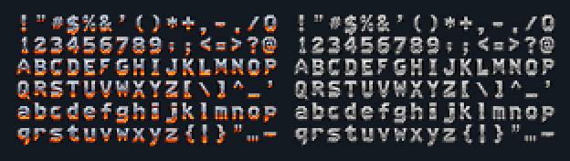
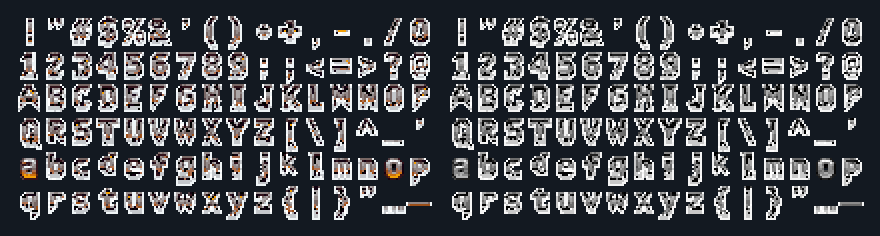
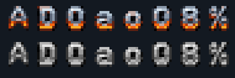
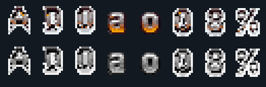
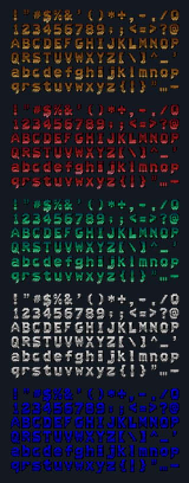

# FONT-NEUTRAL-P1 — Doom palettes neutres (issue #423)

**Assets seulement**. Ces deux BMP sont des variantes **4 bpp indexées**,
prêtes pour une intégration *future* mais **inactives actuellement**.
Il n'y a **aucun changement firmware, HELP, UAC, gameplay, PAK ou framebuffer**.

| Source historique (inchangée) | Nouveau BMP neutre | Grille, cellule | Transparence |
| --- | --- | --- | --- |
| `sdroot/doomrpg/img/a.bmp` | `sdroot/doomrpg/img/a_neutral.bmp` | 144×72, 16×6, 9×12 | Magenta index 0 |
| `sdroot/doomrpg/img/larger_font.bmp` | `sdroot/doomrpg/img/larger_font_neutral.bmp` | 208×102, 16×6, 13×17 | Magenta index 2 |

## Original à gauche, neutre à droite (pixels Doom réels, zoom nearest ×2)





## Vérification rapprochée des glyphes

Ligne supérieure : **originaux**. Ligne inférieure : **neutres**.
Ordre des huit cases, gauche → droite : `A D O a o 0 8 %`.
Les silhouettes et les corrections historiques de `a` et `o` ne sont pas retouchées.





## Simulation de coloration — **hors firmware seulement**

**Chaque rangée provient du même BMP neutre**, sans changer les indices.
Du haut vers le bas :
**CLASSIC** (bronze → or → doré clair),
**INFERNO** (rouge sombre → rouge vif → rose),
**PHOSPHORE** (turquoise sombre → vert électrique → vert pâle),
**blanc**, **bleu pur**.
Le dégradé est calculé selon la hauteur **de chaque glyphe**.
Le magenta n'est affiché qu'en transparence simulée sur un fond sombre.
Ces PNG ne constituent PAS une preuve de rendu RGB565 ou de performances CYD.




Les cinq paliers RGB 8 bits sont définis dans
[`generate.py`](generate.py). Le bleu pur produit (0,0,I)
pour toute encre d'intensité I, sans contamination rouge/vert.
Les contours noirs restent (0,0,0). La future implémentation ESP32
devra traiter la **clé transparente par index** avant la modulation
et arrondir explicitement vers RGB565.

## Palette et compromis vérifiés

La conversion ne réécrit **que les triplets B,G,R** des 15 entrées
non transparentes, jamais leur octet réservé, leur index ou les octets
de pixels. Les deux clés `(255,0,255,0)` restent identiques.

Trois stratégies comparées :

- Moyenne `(R+G+B)/3` : sous-estime certaines zones métalliques claires
  et dilue les contrastes cuivre/argent.
- BT.709 pur : rendu perceptuel cohérent mais les oranges très saturés
  deviennent souvent trop sombres pour les futures teintes.
- Maximum des canaux : rehausse les jaunes/oranges, mais écrase les
  différences entre hautes lumières.

**Méthode retenue** : BT.709 entier avec 20 % du maximum, pour garder
des noirs exacts et une encre suffisamment claire :

```python
L = (2126 * R + 7152 * G + 722 * B + 5000) // 10000
I = (4 * L + max(R, G, B) + 2) // 5
palette[index] = (I, I, I)  # hors magenta
```

| Index 0–15 | `a_neutral.bmp` (I) | `larger_font_neutral.bmp` (I) |
| --- | --- | --- |
| 0 | magenta (transparence) | 0 |
| 1 | 255 | 255 |
| 2 | 0 | magenta (transparence) |
| 3 | 228 | 8 |
| 4 | 197 | 29 |
| 5 | 154 | 68 |
| 6 | 107 | 59 |
| 7 | 56 | 109 |
| 8 | 236 | 140 |
| 9 | 194 | 103 |
| 10 | 149 | 168 |
| 11 | 95 | 133 |
| 12 | 55 | 200 |
| 13 | 14 | 140 |
| 14 | 244 | 181 |
| 15 | 178 | 244 |

**Limites artistiques connues :** une palette ne peut différencier
des pixels qui partageaient déjà un même index. L'opération élimine
nécessairement la distinction chromatique bronze/argent ; les nuances
de luminance seules la remplacent. Deux indices de la grande police
(8 et 13) convergent à 140 : les pixels conservent malgré tout leurs
indices distincts ; ce palier de gris ne peut être séparé sans modifier
la formule ou la couleur lors d'un milestone ultérieur.
Le rendu RGB565 futur peut également fusionner certaines nuances
après quantification, surtout sur teintes sombres : à contrôler en P2/P4.

## SHA-256 exacts (octets BMP 4 bits)

| Fichier | Taille | SHA-256 |
| --- | ---: | --- |
| `a.bmp` **historique** | 5 302 | `e088bb3f65f9314e394443dc659c643fd4cca0cd10fd5782d9b698ca16f8deae` |
| `larger_font.bmp` **historique** | 10 726 | `faa893a06e63a9ca0e223cf2bcc5216950db600a437b01ab68a156eb1b8a4908` |
| `a_neutral.bmp` **nouveau** | 5 302 | `1724b300816bad83aba5017395a51666df532f3f19fcfd4a3958f9e72bf5657f` |
| `larger_font_neutral.bmp` **nouveau** | 10 726 | `43b86d143d6e2e91d165da06e29f322047abeba977878d837cb699d816cb0533` |

## Commandes reproductibles

Depuis la racine du dépôt :

```sh
python3 artwork/fonts/neutral/generate.py --check
python3 ESP32/test/font_neutral_assets_host.py
# Après édition volontaire du générateur (recrée seulement les nouveaux assets et preuves) :
python3 artwork/fonts/neutral/generate.py --write
```

La génération ne dépend **que de la bibliothèque standard Python**.
Les PNG sont écrits en truecolor, sans filtre et avec blocs zlib *stored*
déterministes ; ils n'entrent jamais dans `sdroot/`.
Le test host vérifie le format BMP, les 96 cellules pixel par pixel,
les réparations `a/o`, les masques, les indices/pixels 4 bpp, les SHA
et la reproduction **octet par octet** des deux BMP et six PNG.
Les oracles `ESP32/test/font_sd_assets_host.py` restent **inchangés**.

**Étape suivante — hors P1** : sélectionner explicitement l'atlas neutre,
appliquer des couleurs par appel avec une seule police active par taille,
conserver le fallback coloré SD → PAK et tester HELP/UAC puis le vrai CYD.
Aucun `SD.open` additionnel à chaque couleur, pas de nouveau cache
RGB565 ni de PSRAM obligatoire.
