# Atelier graphique du menu UAC — rééquilibrage 118 px (P2)

**Voir les compositions et les 16 boutons directement dans GitHub.**
Ces images sont assemblées depuis les **18 vrais BMP finaux** du dépôt.
Les 16 boutons sont conservés octet pour octet depuis la PR #399 ; seule la largeur des deux cadres change. Les preuves sont reconstruites exclusivement depuis les 18 BMP finaux.

## Cadre 120 px — quatre boutons et quatre sélections

Cadre **59 × 120**, boutons **55 × 20**. Sur la composition suivante,
START est actif ; LOAD, OPTIONS et HELP sont inactifs.

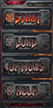

**Preuve de composition des quatre états de sélection :**

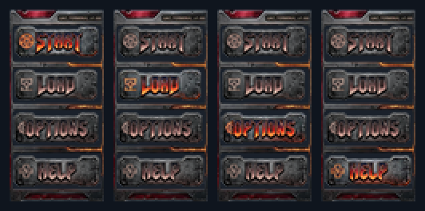

Chaque colonne (de gauche à droite : START, LOAD, OPTIONS, HELP) assemble le cadre et ses quatre boutons avec **un seul
bouton actif**. La planche 120 est agrandie **×2 nearest-neighbor**
pour rester lisible. Le calcul de composition se fait à **59 × 120 natifs**.

## Cadre 240 px — quatre boutons et quatre sélections

Cadre **118 × 240**, boutons **110 × 40**. START est actif dans la
composition de référence :

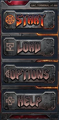

**Preuve de composition des quatre états de sélection à taille native :**

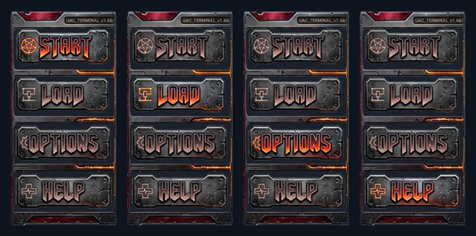

## Catalogue visuel des 16 boutons

Les images ci-dessous sont les vrais boutons BMP alpha **composés sur un
fond sombre d'aperçu** : aucun changement aux fichiers finaux. Les versions
120 sont seulement agrandies ×2 nearest-neighbor pour pouvoir comparer
les deux résolutions côte à côte.

| Bouton | 120 actif | 120 inactif | 240 actif | 240 inactif |
|:--|:--:|:--:|:--:|:--:|
| **START** | 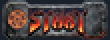 | 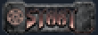 | 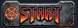 | 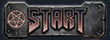 |
| **LOAD** | 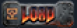 | 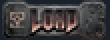 | 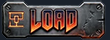 | 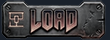 |
| **OPTIONS** | 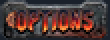 | 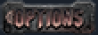 | 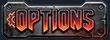 | 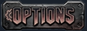 |
| **HELP** | 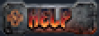 | 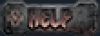 | 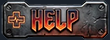 | 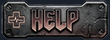 |

Le texte exact du graphisme est **OPTIONS** au pluriel.
La composition d'origine de l'utilisateur (1024 × 572) est disponible
[chez Adobe](https://at.adobe.com/Y8K1xtmZWe8uhufl). Détourage du
damier et préparation des états avec Adobe ; ces preuves sont
ensuite régénérées **exclusivement à partir des BMP du dépôt Git**.

## Organisation : SD propre, atelier séparé

| Dossier | Rôle | À copier sur la SD ? |
|:--|:--|:--:|
| [sdroot/doomrpg/img/](../../sdroot/doomrpg/img/) | **19 BMP finaux** : 18 du menu + credits.bmp | **Oui, pour les images utiles au runtime** |
| artwork/menu-uac/ | Ce README, les aperçus PNG, les preuves de montage, le script et les empreintes | **Non** |
| [ESP32/SD_BOOT_CREDITS.md](../../ESP32/SD_BOOT_CREDITS.md) | Instructions de chargement du BMP des crédits | **Non** |

Le chemin SD cible est **/doomrpg/img/** : le répertoire nommé
sdroot n'est **pas** lui-même à copier comme un dossier sur la carte.
Les images de menu sont chargées uniquement par l'aperçu expérimental UAC
(PR #400 et sa branche de retest P2) ; elles ne remplacent pas le menu classique. Aucun fichier
Markdown, Python ou PNG de travail ne reste dans sdroot/doomrpg/img/.

## Preuve de composition et reproductibilité

Les points d'ancrage sont **locaux au cadre** (x, y). Les quatre
boutons sont dessinés **avant** le cadre, de sorte que les rails et
reflets métalliques passent par-dessus leurs bordures.

| Cadre | Dimensions des boutons | START | LOAD | OPTIONS | HELP |
|:--|:--|:--|:--|:--|:--|
| 120 | 55 × 20 | (2, 10) | (2, 37) | (2, 64) | (2, 91) |
| 240 | 110 × 40 | (4, 20) | (4, 74) | (4, 128) | (4, 182) |

**Ordre des couches :** fond sombre simulé → quatre BMP du menu
avec transparence → BMP métallique du cadre avec transparence.
Les planches prouvent donc la composition en logiciel des images
**existantes**, pour les quatre états de sélection et les deux tailles.
Elles ne constituent **pas** une preuve matérielle sur le CYD et les
positions restent à valider sur l'appareil.

Reproduction sur ordinateur depuis la racine Git (Python 3.12 et
Pillow 11.3.0) :

    python -m pip install Pillow==11.3.0
    python artwork/menu-uac/tools/render_previews.py --write
    python artwork/menu-uac/tools/render_previews.py --check

L'[outil de composition](tools/render_previews.py) contrôle les
**18 SHA-256 des BMP finaux** stockés dans
[SHA256SUMS.txt](SHA256SUMS.txt), les dimensions, les masques de
transparence BMP V4 32 bits BI_BITFIELDS et la géométrie des découpes.
Il génère **16 aperçus de boutons**, **2 compositions START** et
**2 planches de preuves avec les quatre sélections**, soit 20 PNG.
La vérification reconstruit les 20 PNG et compare leurs pixels RGB
(tolérance d'arrondi maximale 2/255 par canal, indépendamment de la compression PNG).

### Traçabilité

Les notices d'origine et leurs métriques sont archivées hors de sdroot :

- [Cadres : notes et SHA-256](notes/MENU_FRAMES.md)
- [START : notes et SHA-256](notes/START_BUTTONS.md)
- [LOAD, OPTIONS, HELP : notes et SHA-256](notes/MENU_BUTTONS_COMPLEMENT.md)

Actions GitHub qui ont généré et vérifié les BMP :
[cadres — SUCCESS](https://github.com/Kharn27/DoomRPG-RE/actions/runs/44565988982),
[START — SUCCESS](https://github.com/Kharn27/DoomRPG-RE/actions/runs/44569358998),
[LOAD/OPTIONS/HELP — SUCCESS](https://github.com/Kharn27/DoomRPG-RE/actions/runs/44572105162).
Preuve de composition dérivée de ces BMP :
[CI générateur — SUCCESS](https://github.com/Kharn27/DoomRPG-RE/actions/runs/44575761589).

**P2 corrigé après nouveau retour CYD :** le cadre est désormais **118 px**
sur 240 physiques et **59 px** dans le mode 120 (×2). Les 16 boutons
restent **rigoureusement les BMP d'origine #399**, soit 110 × 40 ou 55 × 20.
Le bord du cadre n'ajoute plus que **4 px physiques** de chaque côté
(2 px locaux en 120), en préservant **à l'identique le noyau central
110/55 px** du cadre original : seules ses bandes latérales sont repliées.
Le logo gauche dispose de **202 px** contre 162 initialement et 192
dans la première tentative P2. La zone tactile exacte est x206..315.
La version 240 reste physiquement native, le 120 reste nearest-neighbor ×2.

Ces images sont des preuves logicielles, pas un PASS matériel. Le firmware
expérimental PR #400 avec la correction P2 (PR #402) est à retester sur le
vrai classic CYD. Les anciennes notes de la PR #399 sont conservées.
