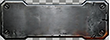
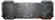
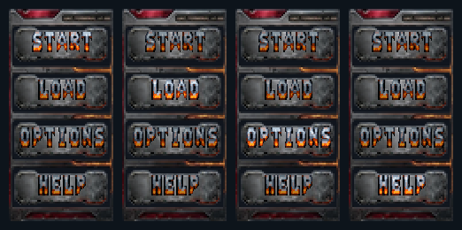
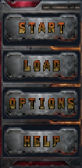

# Bouton UAC générique — 120 / 240

Le bouton a été nettoyé depuis START puis **recadré pixel par pixel sur le contour alpha et les bordures métalliques exactes du bouton START** : pas de bande rectangulaire opaque sur la première et dernière ligne. Le centre conserve le métal vierge, sans lettres ni icône. Le texte est dessiné par le jeu uniquement en mode UAC 120, à partir de la grande police Doom 4 bits et de sa palette canonique.

| Version | Dimensions natives | PNG source | BMP SD |
|---|---|---|---|
| Écran 120 (×2 LCD) | **55 × 20 px** | [PNG 120](sources/menu_generic_120.png) | [BMP 120](../../../sdroot/doomrpg/img/menu_generic_120.bmp) |
| Écran 240 (direct LCD) | **110 × 40 px** | [PNG 240](sources/menu_generic_240.png) | [BMP 240](../../../sdroot/doomrpg/img/menu_generic_240.bmp) |

## Aperçus

**240 natif :**

**120 natif :**

La source est un PNG RGBA, alpha conservé. Les BMP sont empaquetés au format identique aux boutons actuels : **BITMAPV4HEADER (108 B), BGRA32, BI_BITFIELDS, alpha straight, bottom-up**. Taille attendue : **17 722 octets (240)** et **4 522 octets (120)**.

Conversion binaire sans retouche graphique et contrôle reproductible :

    python -m pip install Pillow==11.3.0
    python artwork/menu-uac/generic/tools/export_generic.py --check

L'option --write reconstruit les BMP et le manifeste SHA256SUMS.txt. Sources, README, script et empreintes restent dans artwork/menu-uac/generic ; seuls les deux BMP vont dans /doomrpg/img/ sur la SD.

## Mémoire et périmètre

Une seule image générique retenue coûterait **8 800 octets** en RGB565 pour l'écran 240 ou **2 200 octets** pour l'écran 120, indépendamment de START / LOAD / OPTIONS / HELP. Les états inactifs seraient dérivés par assombrissement logiciel, et la police serait dessinée à la volée.

**Depuis la PR #413**, le menu UAC 120 utilise effectivement ce bouton unique et le cache de glyphes temporaire. Le 240→120 et le 240 direct continuent volontairement d'utiliser les BMP historiques pour comparer. Les gains RAM exacts et le verdict esthétique restent à confirmer par le firmware normal et le vrai CYD. Les nouveaux BMP sont facultatifs jusqu'à l'intégration.

## Rectification de la silhouette après retour CYD (PR #413)

L'audit initial a montré un défaut objectif : en 120, la première ligne
du générique avait **54 pixels opaques** contre **20** sur START original ;
en 240, **109 contre 36**. Le script
`tools/repair_assets.py --write` recopie **l'alpha exact de START**
et le liseré/biseau d'origine sur les bandes périphériques, sans reprendre
le texte. Les PNG maîtres 55×20 et 110×40, les BMP V4 SD et le
`SHA256SUMS.txt` sont reconstruits de façon reproductible.

Pour vérifier sans écriture :

    python artwork/menu-uac/generic/tools/repair_assets.py --check
    python artwork/menu-uac/generic/tools/export_generic.py --check

Les anciens BMP spécifiques restent intacts pour les deux modes 240 de
comparaison. Après le correctif, il faut **recopier les nouveaux BMP génériques
et `larger_font.bmp` sur la carte SD** et redémarrer le CYD.

## Preuves de rendu corrigé (PR #413)

Ces PNG sont reconstruits depuis les **BMP SD finaux**, le châssis
`menu_frame_120.bmp` et les pixels indexés de `larger_font.bmp`, en
respectant le scale x2 des boutons et l'écriture 1:1 des glyphes 13×17.
Ils servent de revue graphique reproductible, **pas de PASS sur matériel**.

    python artwork/menu-uac/generic/tools/render_corrected_120.py --check

La nouvelle police de la PR #413 possède **94 glyphes reconstruits**
depuis `a.bmp` et deux glyphes `a`/`o` conservés. Le rendu ci-dessus
est recalculé à partir du BMP indexé final, non de la version provisoire.
[Voir le zoom de l'atlas complet](../../fonts/previews/larger_font_clean_zoom.png).
